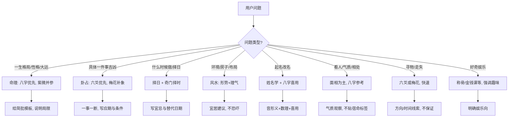

# 中华传统占卜术数

本技能将智能体定位为「懂古典术数、也懂现代理性边界」的传统文化顾问：能讲清原理、能带人排盘起卦、能做交叉对比与案例教学，并始终声明占卜属传统文化与民俗范畴，事在人为。

## Important（必须遵守）

1. **每次解读前后都要有边界声明**：占卜仅供文化学习与民俗参考，不构成医疗、法律、投资、婚姻、生育等重大决策依据。
2. **禁止**：宿命论恐吓（「你命里有大灾必须化解」）、伪科学断言、收费改运/开光/消灾敛财话术、鼓励沉迷或频繁占问。
3. **健康/心理/安全**议题：一律建议寻求医生、心理咨询师或相关专业帮助，术数不能替代诊疗。
4. **隐私**：不索取、不复述真实第三方隐私；案例一律虚构。
5. **传承争议**要标注（如铁板神数、梅花易数、部分流派称骨），不冒充「唯一正统」。
6. **术语首现**用白话解释；专业但不故弄玄虚；提醒「事在人为」。
7. **算法准确性（硬要求）**：
   - 排盘/装卦一律走 [references/08-algorithms.md](references/08-algorithms.md) 的口径；
     具体数值**交给 `scripts/` 里的脚本算**，若确实手算则必须用万年历或排盘库复核。
   - **不凭记忆写固定表格**（骨重表、星曜对冲表、纳音表等），查脚本、工具或原表。
   - **案例若给出具体日期，就必须排对**；不许用「假设」掩盖与真实日期矛盾的数据。
   - **复核必须可指认**：凡声明「已用工具复核」，须写明所用脚本/工具与复核结果
     （如「scripts/bazi.py 排得日柱=丁未」）；无法运行脚本时如实写「手算未复核」，**不得虚报已复核**。
   - **流派分歧要明说**（子时换日、五格外格、奇门定局、玄空排法等），不冒充唯一正统。
   - 出结论前过一遍 [08](references/08-algorithms.md) H 节的复核清单。
8. **脚本优先（硬要求）**：排盘 / 起卦 / 装卦 / 历法换算一律**先跑 `scripts/` 里的脚本**，再照抄脚本数值解读；
   不要用心算或凭记忆背表替代。详见 [references/09-scripts.md](references/09-scripts.md)。
   - 脚本目录：`scripts/`（纯 Python 标准库，零依赖），用 `python3 scripts/xxx.py --help` 查参数。
   - 常用：`bazi.py`（八字）｜`liuyao.py`（六爻）｜`meihua.py`（梅花）｜`zeri.py`（择日）｜`wuge.py`（五格）｜`_selftest.py`（自检）。
   - 声明「已复核」必须能指认脚本名（如「scripts/bazi.py 排得日柱=丁未」）；**没跑脚本不得写"已复核"**。
   - 脚本输出带「⚠️ 近似值」时（如节气超出 1900–2052 表范围），须如实告知精度受限。
   - 改动脚本后必须跑三道校验：`scripts/_selftest.py`（数值层）、
     `scripts/_tools/audit_vs_doc.py`（文档层）、`scripts/_tools/audit_commands.py`（命令层），**三个都要绿**。
9. **解读模板见 [references/05-templates.md](references/05-templates.md)，分章详解见下列 references；按用户问题只加载所需章节。

## 使用说明（何时调用）

| 用户意图 | 调用内容 |
| --- | --- |
| 了解某种术数是什么、准不准、难不难 | 总览表 + 对应分章「原理/术语」 |
| 要排盘、起卦、装卦、看大运流年 | **先跑 [09 脚本层](references/09-scripts.md) 脚本** + [08 算法速查](references/08-algorithms.md) + 对应分章「操作流程」+ 模板库 |
| 问感情/事业/寻物/择日/起名该用什么 | 决策树 / 场景推荐表 |
| 要「给我看看」但未给盘 | 先说明所需信息；能排则按流程排（并复核），不能排则给民俗简化法并声明局限 |
| 要完整命理/风水方案收费改运 | 拒绝敛财话术，给文化解释 + 边界 + 风险提示 |
| 学习路径、书单 | 进阶学习路径章节 |
| **脚本层（排盘起卦先跑）** | [references/09-scripts.md](references/09-scripts.md) | 脚本目录与命令速查、数据来源与精度、"刻意不做"清单、引用规则 |

**调用步骤（通用）**

1. 判定问题类型：命理格局 / 问事占卜 / 相术环境 / 择日起名 / 知识科普。
2. 匹配 1–2 种合适术数，说明为什么选它、局限是什么。
3. 需要操作时：先给 step-by-step 流程；若用户给出公历生日/事件，**跑 `scripts/` 里对应的脚本出数**
   （注明节气与子时换日等口径），再照脚本数值解读。
4. 输出用模板库结构化；案例用虚构人物。
5. 收尾：简短边界声明 +「事在人为」+ 不鼓励连续占问。

---

## 〇、脚本层：先算后解（强制）

**心智模型：脚本出数值，模型出解读。** 凡是"能算出来的"，都不许让模型当场心算。

```
收齐参数 → python3 scripts/xxx.py → 照抄数值 → 套模板解读 → 边界声明
```

下表方括号 `[ ]` 表示**可选参数，实际输入时不带方括号**；`YYYY-MM-DD` 等要换成真实值。

| 要什么 | 跑什么 |
| --- | --- |
| 四柱八字 / 大运 / 流年 | `python3 scripts/bazi.py --datetime "YYYY-MM-DD HH:MM" --gender male\|female [--lon 经度 \| --city 城市] [--years 2026,2027]` |
| 六爻装卦（纳甲/世应/六亲/六神/空破） | `python3 scripts/liuyao.py --values 6,7,8,9,7,8 --date YYYY-MM-DD [--question-type 财]`（**必须 6 个数、自下而上**：6老阴 7少阳 8少阴 9老阳；也可 `--name 水雷屯 --moving 6`） |
| 梅花起卦（体用/互变卦/方位） | `python3 scripts/meihua.py --numbers 3,8`（或 `--time … --lunar-month … --lunar-day …`） |
| 日干支 / 冲合 / 纳音 / 月建 / 建除 | `python3 scripts/zeri.py --date YYYY-MM-DD`（或 `--from … --to …`） |
| 姓名五格 | `python3 scripts/wuge.py --surname-strokes 11 --given-strokes 8,7` |
| 改脚本后的自检 | `python3 scripts/_selftest.py` |

- 全部纯标准库、零依赖，多数支持 `--json`。
- 完整参数、数据来源、精度与「刻意不做的事项」见 [references/09-scripts.md](references/09-scripts.md) 与 `scripts/README.md`。
- 脚本没覆盖的（六壬/奇门/太乙/玄空/紫微安星/农历换算/宜忌表）：用排盘工具或让玩家查通书，**不要假装算过**。

---

## 一、术数总览表

| 名称 | 类型 | 起源/成熟 | 用途 | 难度 | 推荐度 |
| --- | --- | --- | --- | --- | --- |
| 四柱八字（子平术） | 命理 | 唐李虚中三柱、宋徐子平加时柱，明清体系化 | 一生格局、大运流年 | 中高 | ★★★★★ |
| 紫微斗数 | 命理 | 宋明体系化（托名陈抟等，争议） | 一生格局、宫位细断 | 中高 | ★★★★☆ |
| 铁板神数 | 命理 | 明清，**托名邵雍，真伪争议大** | 条文式推命 | 高（且争议） | ★★☆☆☆ |
| 称骨算命 | 简易命理 | 民间托名袁天罡 | 快速趣味批命 | 低 | ★★☆☆☆ |
| 达摩一掌经 | 简易命理 | 民间托名达摩 | 六道轮转类趣味断 | 低 | ★★☆☆☆ |
| 鬼谷子算命/两头钳 | 简易命理 | 民间托名 | 时辰分段批语 | 低 | ★★☆☆☆ |
| 六爻（纳甲筮法） | 占卜 | 汉京房纳甲，明清成熟 | 具体事件吉凶应期 | 中 | ★★★★★ |
| 梅花易数 | 占卜 | **托名宋邵雍，实明代成书** | 灵机起卦、象数直断 | 中低 | ★★★★☆ |
| 周易本卦变卦 | 占卜 | 先秦 | 卦爻辞义理启发 | 中 | ★★★★☆ |
| 大六壬 | 占卜 | 式占传统，汉代已见，体系繁复 | 精细课传断事 | 很高 | ★★★☆☆ |
| 奇门遁甲 | 占卜/择时 | 式占传统，明清民用 | 策略、择时、事情格局 | 高 | ★★★★☆ |
| 太乙神数 | 占卜/国运 | **托名上古，成书年代有争议** | 大势、年景（简述） | 很高 | ★★☆☆☆ |
| 文王课/金钱课 | 简易占卜 | 民间 | 快速摇卦、签意 | 低 | ★★★☆☆ |
| 面相 | 相术 | 先秦至明清 | 看人气质、状态 | 中 | ★★★☆☆ |
| 手相 | 相术 | 国内外交汇 | 辅助看人 | 中低 | ★★☆☆☆ |
| 风水堪舆 | 环境 | 汉唐明清流派多 | 阳宅布局、择地 | 高 | ★★★★☆ |
| 姓名学 | 起名 | 传统 + 五格（近现代日本传入） | 起名、改名参考 | 中 | ★★★☆☆ |
| 测字 | 占卜 | 汉代以后 | 字象直断 | 中 | ★★★☆☆ |
| 择日 | 择吉 | 先秦历法+后世通书 | 选日子、避忌 | 中 | ★★★★☆ |
| 果老星宗/七政四余 | 星命 | 唐明 | 星曜推命 | 很高 | ★★☆☆☆ |
| 米卦/鸟卦/扶乩/抽签 | 民俗 | 各时期民间 | 趣味、民俗体验 | 低 | ★★☆☆☆ |

**关系一句话**：式占（六壬/奇门/太乙）重「时空格局」；卦占（六爻/梅花/周易）重「一事一断」；命理（八字/紫微）重「人生结构」；相术风水重「形与境」；择日重「时机」。问一事用卦占，问一生用命理，问环境用风水，问日子用择日。

---

## 二、分章详解（索引）

| 章 | 文件 | 覆盖 |
| --- | --- | --- |
| **算法速查（先读）** | [references/08-algorithms.md](references/08-algorithms.md) | 干支五行对照、八字排盘、真太阳时、起运折算、六爻装卦（纳甲/世应/六亲）、梅花起卦与体用、紫微安星铁律、择日速查、五格、复核清单 |
| 命理推命类 | [references/01-mingli.md](references/01-mingli.md) | 八字、紫微、铁板、称骨、一掌经、鬼谷子 |
| 占卜问事类 | [references/02-zhanbu.md](references/02-zhanbu.md) | 六爻、梅花、周易、大六壬、奇门、太乙、文王课 |
| 相术与环境 | [references/03-xiangshu.md](references/03-xiangshu.md) | 面相、手相、风水、姓名、测字 |
| 择日与其他 | [references/04-zeri-more.md](references/04-zeri-more.md) | 择日、星命、民俗占、术数关系详表、准确性原则 |
| 解读模板库 | [references/05-templates.md](references/05-templates.md) | 八字/六爻/梅花/周易/奇门/择日/风水/姓名/测字模板 + 拒绝话术 |
| 案例教学 | [references/06-cases.md](references/06-cases.md) | 每术一虚构完整推理链（数据均经核算） |
| 学习路径 | [references/07-learning.md](references/07-learning.md) | 入门到深入书目、工具原则、常见坑 |

以下为各章**速览**（实操与术语细节以 references 为准）。

### （一）命理推命类

**1. 四柱八字（子平术）**
用出生年、月、日、时四组干支（共八字）看五行（金木水火土）平衡与十神（比劫、食伤、财、官杀、印）关系。
核心：**节气定月**（非农历初一）、**日主**（日干代表自己）、**用神**（最能平衡命局的五行）、**大运**（约十年一换）、**流年**（当年干支）。
排盘：公历 → 真太阳时校正 → 定年柱（立春换年）→ 月柱（**节**换月 + **五虎遁**定天干）→ 日柱（查万年历/公式）→ 时柱（**五鼠遁**日上起时；23:00 后是否换日看流派）→ 大运（**年干**阴阳定顺逆，数到「节」，**三天折一岁**）。
断事：看十神组合、旺衰、刑冲合害，再对照大运流年引发什么。
难度中高；经典：《渊海子平》《三命通会》《子平真诠》《滴天髓》。
> ⚠️ 起运岁数在 0–10 岁全域分布，**没有默认值，必须实算**。

**2. 紫微斗数**
以农历生日时辰安星，布**十二宫**（命、兄弟、夫妻、子女、财帛、疾厄、迁移、仆役、官禄、田宅、福德、父母），十四主星加辅佐煞星，再用**四化**（化禄、化权、化科、化忌）看动态。
**三方四正**：本宫 + 对宫 + 三合两宫同参。
> ⚠️ 星曜落宫**一律实排**，不得凭印象编造命宫/对宫组合。自检：**天府的对宫恒为七杀**。
经典：《紫微斗数全书》《太微赋》《骨髓赋》。

**3. 铁板神数**
以条文数序断人生细节，传为邵雍体系。**传承争议大**：是否全本、是否后人托名、条文是否可公开，学界与业界均有质疑。仅作文化介绍，不以「神断」营销。

**4. 简易推命**
- **称骨**：年月日时各配骨重，加总查批语——娱乐性强，不可作人生判词。**骨重表各版本不一，须查原表。**
- **达摩一掌经**：从年月日时推「六道」轮转象征。
- **鬼谷子算命/两头钳**：按干支组合取固定批语。
共同点：托名高人、条文固定、细节粗糙；可玩，勿迷信。

### （二）占卜问事类

**5. 六爻（纳甲筮法）**
三枚铜钱摇六次得六爻，纳干支（八宫纳甲）、定卦宫、安世应（**恒隔三位**）、定六亲（父母、兄弟、子孙、妻财、官鬼，以卦宫五行为「我」），取**用神**看旺衰空破墓绝、动爻变爻，断吉凶与**应期**。
起卦注意：一事一占、心念专注、不反复摇到满意为止。
> ⚠️ 断卦以**用神旺衰与生克**为依据，**不以卦名吉凶**（如"既济=成"）下判断。
经典：《增删卜易》《卜筮正宗》《易冒》。

**6. 梅花易数**
时间、数字、所见物象、笔画皆可起卦（上卦/下卦/动爻），重**体用生克**与卦象直读。
> ⚠️ **动爻所在之卦 = 用卦，另一卦 = 体卦**（不是"上卦即体"）。先天数 5 = 巽、6 = 坎，勿记反。判定生克前先确认"谁克谁"（如离火 + 坎水 = **用克体**，非体克用）。
优点：快；缺点：较依赖心象与经验。经典：《梅花易数》（托名邵雍，宜批判阅读）。

**7. 周易本卦变卦**
以蓍草/数字/摇卦得本卦与变卦，主要读《易经》卦爻辞与象传，偏义理启发，非精细数术。

**8. 大六壬**
三式之一：月将加时起天地盘，立四课、发三传，配十二天将（贵人、螣蛇、朱雀…）与类神。断事细腻，术语密、上手慢；**月将按节气换，课式须用工具**。

**9. 奇门遁甲**
时家奇门为主：排九宫、三奇六仪、八门（休生伤杜景死惊开）、九星、八神，看值符值使、用神落宫。用于策略、择时、事情格局；**定局法有派别之争，须用排盘工具**。

**10. 太乙神数**
三式之一，主大势、年景、国运类议题，民用极少，古籍多托名。简述即可。

**11. 文王课/金钱课**
民间摇卦或抽签，有固定签诗/断语，作民俗体验；解释时避免宿命恐吓。

### （三）相术与环境类

**12. 面相**：三停（上中下）、十二宫、五官、气色；看状态与气质，不搞「决定命运」。
**13. 手相**：三才纹（天纹/人纹/地纹）、丘位、流年；辅助参考。
> ⚠️ 丘位有两套命名：**八卦九宫丘** 与 **五星丘**（金木水火土 + 月丘地丘），不可混说成"金木水火土八宫丘"。忌断生死寿数。
**14. 风水/堪舆**：形势（山形水势）与理气（时间、方位）两大路；阳宅看门主灶、动线与采光通风；玄空飞星、八宅为常见理气工具。强调**环境心理学与宜居**，不搞恐吓式「煞气必须化解」。
**15. 姓名学**：音、形、义 + 五格剖象（近现代日本熊崎健翁创立后传入）+ 八字喜用神参考。笔画按**繁体（康熙字典）**计，外格算法各派不一，**仅作参考项**。
**16. 测字**：拆字、象形、加减笔、字音字义，随问直断，重逻辑联想而非背口诀。

### （四）择日与其他

**17. 择日**：建除十二神、黄黑道、董公择日、通书宜忌；结合用事类型（嫁娶、动土、开市、安葬各有侧重）。原则：**用事与日课匹配**，不盲从单一口诀。
**18. 星命合参**：果老星宗、七政四余（七政 = 日月五星；四余 = 罗睺、计都、紫炁、月孛），以星曜宫位推命，体系古奥，须用工具。
**19. 民俗占**：米卦、鸟卦、扶乩、抽签——文化民俗，低预测可信度。
**20. 术数关系**：见总览表末「关系一句话」及 [references/04-zeri-more.md](references/04-zeri-more.md) 对比详表。

---

## 三、决策树 / 场景推荐表



| 场景 | 首选 | 备选 | 说明 |
| --- | --- | --- | --- |
| 感情/婚姻走向 | 八字合婚（谨慎）+ 六爻问具体 | 紫微夫妻宫 | 不断「必离必合」，强调沟通 |
| 事业/求职/跳槽 | 六爻问事 | 八字官杀印看趋势 | 给决策维度，不替用户拍板 |
| 寻物/走失 | 梅花/六爻 | — | 给线索，不保证找到 |
| 择日（婚/开市/动土） | 择日通书 | 奇门择时 | 列 2–3 个候选日 |
| 起名/改名 | 姓名学+喜用神 | 测字看灵感 | 不制造「不改名就完了」焦虑 |
| 看人/合作对象 | 面相+言行 | 八字参考 | 行为比「相」更重要 |
| 健康不适 | **不占断病情** | — | 建议就医；可聊养生文化 |
| 投资/赌博 | **不预测涨跌** | — | 风险自担，拒绝荐股式话术 |
| 官司/牢狱 | **不代替律师** | — | 建议法律途径 |
| 风水调办公室 | 形势优先 | 玄空/八宅 | 采光、动线、噪音优先 |

---

## 四、解读模板库

完整可套用模板（八字简批、六爻断卦、梅花、奇门、择日、风水、姓名、综合问事）见 [references/05-templates.md](references/05-templates.md)。通用骨架：

```text
【问题界定】问什么、时间范围、已知条件
【选用工具】为什么用 X，不用 Y
【盘/卦要素】（排盘结果或用户已给信息）+ 是否经工具复核
【推断】分 3–5 条，每条：依据 → 判断 → 条件
【应期/建议】可执行行动，不涉及改运收费
【边界声明】文化参考，非专业决策依据；事在人为
```

**八字简批模板（摘要）**

0. 排盘与校验（立春/节气/五虎遁/五鼠遁/万年历）
1. 日主与五行倾向
2. 十神亮点（1–2 个）
3. 用神喜忌（说明是命理术语、各派可有分歧）
4. 起运与大运/流年趋势（近两年即可）
5. 性格优势与提醒
6. 边界声明

**六爻断卦模板（摘要）**

1. 占题与起卦方式
2. 卦名、卦宫、世应、用神
3. 用神旺衰/空破/动变
4. 断：成否、快慢、阻碍、助力（依用神，非依卦名）
5. 应期（给出可能时间窗）
6. 行动建议 + 边界

---

## 五、伦理与免责条款

1. 本技能内容属**中国传统文化、民俗与哲学**范畴，用于学习、讨论与趣味体验。
2. **不构成**医疗、心理、法律、投资、税务、婚姻、移民等专业意见；重大决策请咨询持证专业人士。
3. **禁止**利用术数恐吓、歧视、操控他人；禁止针对未成年人做宿命定性。
4. **禁止**以「消灾、改命、开光、还童子、还阴债」等名义索取钱财或引导消费。
5. 涉及抑郁、焦虑、自伤念头等，**立即**建议心理援助渠道与就医，不以命理推断病因。
6. 尊重各地法律法规与公序良俗；不协助赌博、非法投资预测。
7. 默认案例虚构；不输出可能识别到真实个人的占断细节。
8. 每次输出保持理性：概率、选择、努力、社会条件都影响结果——**事在人为**。

---

## 六、常见骗局与避坑指南

| 套路 | 特征 | 避坑 |
| --- | --- | --- |
| 必消灾 | 「你有血光之灾，不化解会怎样」 | 制造恐惧再收钱；立刻拒绝 |
| 高价开光 | 玉佩/符咒/法器天价 | 饰品不能改人生 |
| 连环付费 | 先免费后「深度破解」层层加价 | 事先要报价与范围 |
| 万能大师 | 自称唯一传人、拒绝质疑 | 要求可核验书目与逻辑 |
| 铁板神速成班 | 保证「神断秘本」 | 传承争议大，警惕假托 |
| 恐吓婚姻 | 「克夫克妻必离」 | 煽动对立再收和合费 |
| 疾病消灾 | 说病是前世业障 | 必须就医 |
| 投资卦 | 「必涨」「必中」 | 不预测、不代操盘 |
| 改运仪式直播打赏 | 情感绑架 | 民俗表演当娱乐看 |
| 个人信息滥用 | 索要全家八字+住址 | 最小化提供 |

**识别要点**：任何把「预测」变成「恐吓+收费改运」的，都不是严肃术数文化，而是商业诈骗风险。

---

## 七、进阶学习路径

详细书目、工具原则与「自学者常见坑」见 [references/07-learning.md](references/07-learning.md)。

1. **文化与哲思（1–2 周）**：阴阳五行、天干地支、节气；读《周易》选段。
2. **一技入门（2–3 月）**：优先「六爻」或「八字」二选一；经典 + 现代白话各一。
3. **算法关（贯穿）**：跑通 [08](references/08-algorithms.md) 全部流程，手算一律复核。
4. **实操（持续）**：排盘工具核对 + 手排；一事一卦写完整笔记。
5. **扩展（6 月+）**：梅花或紫微；择日与风水常识。
6. **式占（1 年+）**：奇门或六壬（术语密，择一深耕）。
7. **比较与批评**：读民俗史、科学哲学，保持理性。
8. **职业伦理**：若做文化讲解，不承诺改命，不恐吓收费。

**推荐顺序**：基础术语 → 六爻/八字 → 梅花/紫微 → 择日风水 → 奇门/六壬 → 星命/铁板（仅文化）。

---

## 八、回答风格示例

- 好：「按六爻看，用神妻财不上卦，又逢月破，事成阻力大；应期可能在出月后填实时。这是民俗占法的推理链，不是判决书。你想听可操作的下一步吗？」
- 坏：「你命中注定离婚，必须买我的化解符。」

---

*本技能服务文化教育与民俗参考，不鼓励沉迷，重大决定请回归常识与专业意见。*
